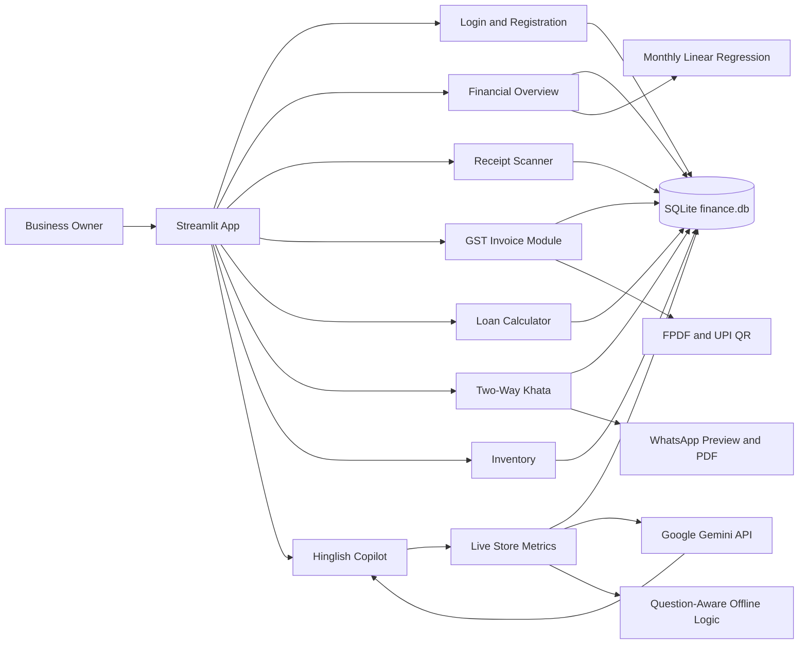

# VyaparMitra AI

<div align="center">

**Your Smart AI Business Partner for Everyday Business Finance**

An AI-powered financial management platform for Indian MSMEs, Kirana stores, and small retailers.

[](https://www.python.org/)
[](https://streamlit.io/)
[](https://www.sqlite.org/)
[](https://ai.google.dev/)
[](https://youtu.be/UNpI-8kASYM)

[Watch the Demo](https://youtu.be/UNpI-8kASYM) · [View Source Code](https://github.com/rajatjaiswal032-droid/vyaparmitra-ai-smart-business-finance)

</div>

---

## Project Demo

[](https://youtu.be/UNpI-8kASYM)

**YouTube:** https://youtu.be/UNpI-8kASYM

---

## Project Overview

VyaparMitra AI is a Python and Streamlit application for small Indian businesses. It brings commonly disconnected tasks into a single workspace: transaction tracking, cash-flow forecasting, inventory management, 2-way Khata, Galla reconciliation, GST invoicing, loan planning, receipt scanning, and Hinglish AI assistance.

It is designed for Kirana store owners, small retailers, and local shopkeepers who need a practical view of:

- Daily income and expenses
- Future cash balance
- Stock and expiry risks
- Customer receivables
- Supplier payables
- GST and UPI payment workflows
- Loan affordability

## Problem Statement

Small businesses often manage records across notebooks, spreadsheets, payment apps, and GST paperwork. This can make it difficult to:

- Calculate current revenue and expenses consistently
- Estimate upcoming cash requirements
- Find the highest-cost expense categories
- Track which customers owe money
- Track supplier payments that are still due
- Detect low-stock and near-expiry items
- Produce invoices and account for tax splits
- Interpret financial information without specialist software

## Our Solution

VyaparMitra AI centralizes these workflows behind a Streamlit dashboard backed by a local SQLite database. Existing modules calculate summaries and forecasts, store user-specific records, generate PDFs and QR images, and prepare live business metrics for a Gemini-powered Copilot.

The application also includes Python fallback responses so its core Khata, forecasting, profit, expense, stock, and loan guidance remains usable if Gemini is unavailable.

---

## Key Features

### Financial Dashboard

- Total Revenue
- Total Expenses
- Net Profit or Loss
- Next-month projected balance
- Plotly grouped income, expense, and net-profit charts
- Top expense category breakdown
- Searchable recent transactions
- Monthly profit-goal progress
- Manual income and expense entry

### Cash-Flow Forecasting

The forecasting module in `forecasting.py`:

1. Converts transaction dates to monthly `YYYY-MM` periods.
2. Aggregates monthly income and expenses.
3. Calculates monthly net profit/loss and a running closing balance.
4. Uses Scikit-learn `LinearRegression` for the next month when at least two months exist.
5. Uses the latest month's values as a fallback for datasets with fewer than two months.

Predictions are estimates based on the available records, not guaranteed outcomes.

### Daily Galla Closing

The Financial Overview screen includes a daily galla reconciliation expander:

- Opening cash
- Actual cash in galla
- Actual UPI received
- System cash sales derived from today's stored transactions
- Cash expenses derived from today's stored transactions
- Matched, short, or excess cash status
- Saved notes and reconciliation values

The saved record is stored in the `daily_closings` SQLite table.

### CSV and Excel Import/Export

The Financial Overview includes transaction download and upload workflows:

- Export transactions as CSV
- Export transactions as Excel
- Import CSV or Excel bank/store statements using `date`, `type`, `category`, `description`, and `amount`
- Detect meal-plan columns (`meal_name`, `quantity_prepared`, `quantity_consumed`) and convert them into income and expense records

### Inventory and Stock

- Add and restock inventory items
- Store unit, stock quantity, minimum stock, selling price, and GST rate
- Store an optional expiry date
- Show low-stock warnings
- Show items expiring within 30 days
- Deduct quantities when GST invoice items are sold
- Restock quantities from receipt and restock workflows

### AI Receipt Scanner

The scanner supports:

- JPG or PNG uploads
- `st.camera_input` camera capture
- A generated sample Kirana bill for demonstrations
- Editable vendor, date, invoice number, amount, GST amount, category, and item fields
- Duplicate-bill warnings based on vendor, amount, and date
- Save to expenses
- Save expense plus restock inventory

Gemini receipt extraction is implemented with structured JSON prompts. If no key or a provider/model call fails, the app reports an offline verification state rather than presenting a confirmed scan.

### GST Invoice Generator

- Dynamic customer and seller state inputs
- Dynamic item rows
- GST rates of 0%, 5%, 12%, 18%, and 28%
- CGST + SGST for same-state transactions
- IGST for different-state transactions
- FPDF GST invoice download
- GST summary CSV for the current month
- Monthly invoice totals for taxable sales and CGST, SGST, and IGST
- QR and invoice payment PDF workflows

Tax outputs are application calculations and should be reviewed against the applicable tax treatment.

### UPI Payment QR

The GST and Udhaar sections generate UPI payment QR images from a configurable Store UPI ID and payee name.

The implementation creates an encoded `upi://pay` URI with:

- `pa`
- `pn`
- `am`
- `cu=INR`
- `tn`

The GST invoice and Pending Udhaar PDF helpers can embed generated QR PNG images. The UPI setup shown by the application must be verified by the store owner before real use.

### Loan and EMI Planner

The loan calculator:

- Calculates the monthly EMI using a reducing-balance formula
- Returns total payment and total interest
- Calculates EMI as a percentage of average monthly profit
- Classifies the result as Safe, Moderate, or High Risk
- Displays a practical Hinglish/English recommendation

The result is a planning estimate, not a bank approval or credit rating.

### Two-Way Udhaar / Credit Khata

The Khata module supports:

- `Customer - Lena Hai` receivables
- `Supplier - Dena Hai` payables
- Cash or UPI payment mode
- Pending/Paid status
- Partial payments
- Automatic remaining-balance updates
- Income or expense transaction logging for recovered or paid amounts
- WhatsApp reminder previews
- Pending Bill + QR PDF downloads

WhatsApp buttons open a pre-filled WhatsApp link. They do not send messages automatically.

### Hinglish AI Copilot

The Copilot receives live values prepared by `app.py`, including:

- Total income
- Total expense
- Net profit
- Top expense category
- Forecasted balance
- Pending Udhaar
- Low-stock items
- Customer receivables
- Supplier payables
- Near-expiry items

The user can enter text or use the Streamlit audio input workflow. Gemini is used for generated answers and transcription when available. Question-aware Python fallbacks provide live store calculations if the API key is missing or Gemini calls fail.

---

## Technology Stack

| Area | Technology |
|---|---|
| Interface | Streamlit |
| Language | Python |
| Database | SQLite |
| Authentication | bcrypt password hashing |
| Data processing | Pandas |
| Charts | Plotly |
| Forecasting | scikit-learn `LinearRegression` |
| AI SDK | Google Gen AI SDK (`google-genai`) |
| AI/vision models | Configured model fallback: `gemini-2.5-flash`, `gemini-2.0-flash`, `gemini-flash-latest` |
| Environment variables | python-dotenv |
| PDF generation | FPDF2 (`fpdf.FPDF`) |
| Image handling | Pillow |
| QR generation | qrcode with Pillow |
| Excel support | openpyxl |
| Text-to-speech | gTTS |

---

## System Architecture



### AI Data Boundary

The application does not give Gemini direct SQLite access. `app.py` or `ai_assistant.py` gathers or receives live summary values and includes those values in a prompt. Gemini returns text or structured JSON based on the prompt.

---

## Project Workflow

1. The user starts the Streamlit application.
2. The owner logs in or registers a business account.
3. The demo store login seeds a demonstration account and related records.
4. The dashboard reads user-scoped transactions and calculates totals.
5. The forecasting module creates monthly aggregations and a next-month projection.
6. Inventory, Khata, Galla, and invoice modules read and update SQLite records.
7. Receipt or Copilot requests call Gemini when an API key and provider are available.
8. If Gemini fails, receipt verification or question-aware local fallback logic is used.
9. PDFs, CSV files, Excel files, WhatsApp links, and QR images are generated for download or sharing.

---

## Project Structure

```text
vyaparmitra-ai-smart-business-finance/
├── app.py
├── auth.py
├── database.py
├── ai_assistant.py
├── forecasting.py
├── gst_invoice.py
├── loan_calculator.py
├── requirements.txt
├── .gitignore
├── README.md
├── .streamlit/
├── .vscode/
├── seed_realistic_data.py
├── import_web_data.py
├── demo_test_notes.md
├── real_kirana_2026.csv
└── sample_kirana_data.csv
```

Excluded by `.gitignore`:

- `.env`
- `venv/`
- `__pycache__/`
- `*.db`
- `*.pdf`
- `*.png`

---

## Database Architecture

`database.py` initializes `finance.db` automatically when imported.

| Table | Purpose |
|---|---|
| `users` | Username, bcrypt password hash, and business name |
| `transactions` | User-scoped income and expense records |
| `invoices` | Customer, seller, item JSON, GST, and total invoice values |
| `loans` | Saved loan EMI and risk information |
| `udhaar` | Customer and supplier credit entries, partial payments, status, and payment mode |
| `inventory` | Stock quantity, minimum stock, selling price, GST rate, and expiry date |
| `daily_closings` | Opening cash, system totals, actual galla/UPI, difference, and notes |

The main relationship is `user_id` foreign-key scoping for store-specific application records.

Existing database tables are retained while migrations add:

- `inventory.expiry_date`
- `udhaar.entry_type`
- `udhaar.payment_mode`
- `udhaar.paid_amount`

The database file is local and should not be committed.

---

## Installation and Setup

### Prerequisites

- Windows 10 or 11
- Python 3.10 or later
- Git
- Internet access for optional Gemini and voice features

### Clone

```powershell
git clone https://github.com/rajatjaiswal032-droid/vyaparmitra-ai-smart-business-finance.git
cd vyaparmitra-ai-smart-business-finance
```

### Create a Virtual Environment

```powershell
python -m venv venv
```

### Activate on Windows

```powershell
.\venv\Scripts\Activate.ps1
```

If script execution is restricted:

```powershell
Set-ExecutionPolicy -Scope Process -ExecutionPolicy Bypass
.\venv\Scripts\Activate.ps1
```

### Install Dependencies

```powershell
python -m pip install --upgrade pip
python -m pip install -r requirements.txt
```

### Initialize the Database

The database is initialized automatically when `database.py` or `app.py` imports it:

```powershell
python -c "import database"
```

This creates `finance.db` and required tables locally.

### Run the Application

```powershell
streamlit run app.py
```

The local URL is normally `http://localhost:8501`.

---

## Environment Variables

Create `.env` in the project root:

```dotenv
GEMINI_API_KEY=your_api_key_here
```

| Variable | Required for |
|---|---|
| `GEMINI_API_KEY` | Gemini Copilot, receipt extraction, and Gemini voice transcription |

Do not commit `.env` or real credentials. The application loads `.env` with override enabled for AI calls.

---

## Screenshots and Demo

The repository does not currently include a verified screenshot directory.

### Suggested Screenshots

| Screenshot | Place shown |
|---|---|
| Login and 1-click demo login | Entry screen |
| KPI cards and Plotly chart | Financial Overview |
| Galla closing expander | Financial Overview |
| Camera/uploaded bill and extracted fields | AI Receipt Scanner |
| GST tax breakdown and UPI QR | GST Invoice Generator |
| EMI metrics and risk badge | Loan & Safe EMI Planner |
| Lena Hai and Dena Hai entries | Udhaar / Credit Khata |
| Low-stock and expiry alerts | Inventory / Financial Overview |
| Hinglish Copilot chat | AI Business Copilot |

Add images to a future `screenshots/` directory and link them here.

---

## Sample AI Interactions

### English

- What is my current net profit?
- Which expense category is highest?
- What is my next-month projected balance?
- Which low-stock items need reordering?

### Hinglish

- Mere business ka total profit kitna hai?
- Sabse zyada kharcha kahan ho raha hai?
- Kitne logon se udhaar lena hai aur kitna pending hai?
- Wholesalers ko kitna payment dena baaki hai?
- Kaunsa stock expire hone wala hai?
- Kya ₹2,50,000 ka loan lena safe rahega?

### Hindi

- मेरा कुल लाभ कितना है?
- अगले महीने अनुमानित शेष कितना है?
- किस उत्पाद का स्टॉक कम है?

---

## Testing and Verification

There is no dedicated automated test suite in the repository. Compilation can be verified on Windows with:

```powershell
.\venv\Scripts\python.exe -m py_compile app.py auth.py ai_assistant.py database.py forecasting.py gst_invoice.py loan_calculator.py
```

Manual smoke checks:

- Demo login creates or retrieves the demo account.
- Transaction CRUD updates revenue, expenses, and net profit.
- Galla values show matched, short, or excess status.
- CSV and Excel exports download successfully.
- Receipt upload/camera produces editable fields or an explicit offline state.
- GST PDF, P&L PDF, and pending Khata PDF download as valid FPDF output.
- QR images use the configured UPI ID and store name.
- Inventory restock/deduction updates stock quantities.
- Partial Khata payment updates the remaining balance and creates a transaction.
- Copilot fallback questions return store-specific values.

---

## Security and Privacy

- Passwords are hashed using bcrypt.
- Application data is stored locally in SQLite.
- The Copilot is given prepared store summaries, not direct database access.
- `.env` must remain outside source control.
- `.db`, `.pdf`, and generated `.png` files are ignored.
- Demo and public presentations should use dummy customer and financial values.
- Real UPI settings must be tested and verified with the store owner.
- Gemini-generated output should be reviewed by the store owner.
- Forecasts and loan risk indicators are estimates, not formal financial advice.

---

## Known Limitations

- No dedicated automated test suite is included.
- The application is designed for local SQLite use and is not a hosted multi-device system.
- Gemini features require an API key, network access, and provider availability.
- Receipt extraction depends on image quality and model output.
- Voice support depends on Streamlit browser support and provider availability.
- WhatsApp actions open pre-filled links; the app does not send messages automatically.
- GST output is an invoice calculation helper, not filing or tax authority integration.
- UPI QR verification and payment confirmation require real-world testing.
- The supplied sample CSV files should be reviewed for provenance and redistribution requirements.

---

## Future Scope

- Hosted authentication and database storage
- Automated tests and CI/CD
- Bank and POS statement reconciliation
- More advanced forecasting models
- Barcode and batch/lot inventory support
- GST filing integrations
- WhatsApp Business API integration
- Cloud backups and audit logs
- Mobile application or deployment
- Enhanced role-based access

---

## Team

| Name | Role |
|---|---|
| Rajat Jaiswal | Team Lead & Developer |
| Prince Sahu | Team Member |

- Institution: Bansal Institute of Research and Technology
- Department: CSE – Data Science
- Hackathon: Arthaton 2026

---

## Acknowledgements

Thanks to the open-source communities behind Python, Streamlit, SQLite, Pandas, Plotly, Scikit-learn, FPDF2, Pillow, Google Gen AI, and gTTS.

---

## Repository

https://github.com/rajatjaiswal032-droid/vyaparmitra-ai-smart-business-finance
