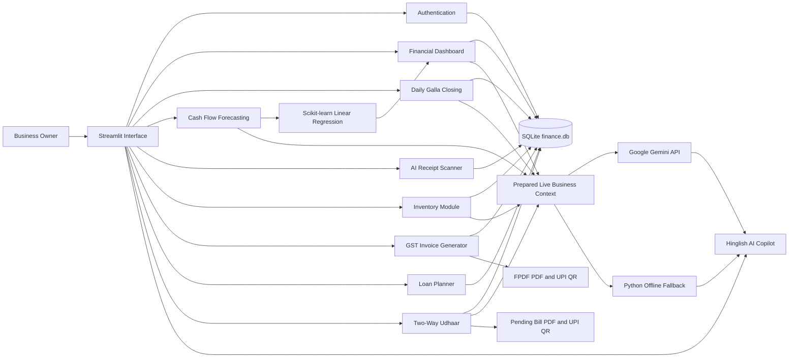

# VyaparMitra AI

<div align="center">

**Your Smart AI Business Partner for Everyday Business Finance**

AI-assisted financial operations for Indian MSMEs, Kirana stores, and local small businesses.

[](https://www.python.org/)
[](https://streamlit.io/)
[](https://www.sqlite.org/)
[](https://ai.google.dev/)
[](https://youtu.be/UNpI-8kASYM)

[View Demo](https://youtu.be/UNpI-8kASYM) · [View Repository](https://github.com/rajatjaiswal032-droid/vyaparmitra-ai-smart-business-finance)

</div>

---

## Project Demo

The following demo video shows the working VyaparMitra AI application and its main business workflows.

[](https://youtu.be/UNpI-8kASYM)

**Demo video:** https://youtu.be/UNpI-8kASYM

---

## Project Overview

VyaparMitra AI is a local Python and Streamlit application for small Indian businesses. It brings transaction tracking, financial summaries, monthly forecasting, Galla reconciliation, inventory monitoring, GST invoice preparation, EMI planning, customer/supplier Khata, UPI QR generation, and a Hinglish AI Copilot into one interface.

The project is intended for Kirana stores and small retailers that need a clearer view of:

- Daily income and expenses
- Cash and UPI balances
- Projected cash position
- Customer receivables
- Supplier payables
- Low-stock and near-expiry products
- GST invoice details
- Practical loan planning

## Problem Statement

Small businesses commonly maintain records across notebooks, payment apps, spreadsheets, and separate GST or inventory tools. This fragmentation makes it difficult to:

- Reconcile daily cash and UPI collections
- Know which customers owe money
- Know which suppliers still need payment
- Identify stock shortages or near-expiry items
- Review revenue, expenses, and net profit
- Prepare estimated future cash-flow projections
- Use financial records for timely business decisions

## Our Solution

VyaparMitra AI combines related operational and financial workflows in a Streamlit interface backed by local SQLite storage. Python modules calculate summaries, forecasts, EMI values, GST totals, Khata balances, and prepared business context. Gemini receives that prepared context for AI-generated explanations and does not access SQLite directly.

The application also includes question-aware Python fallback responses for Copilot use when Gemini is unavailable or a valid API key is not configured.

---

## Key Features

### Financial Dashboard

- Total Revenue
- Total Expenses
- Net Profit or Loss
- Next-month projected balance
- Plotly income/expense and net-profit charts
- Expense category breakdown
- Profit-goal progress
- Searchable recent transaction table
- Manual income and expense entry

### Cash-Flow Forecasting

`forecasting.py`:

1. Converts transaction dates into `YYYY-MM` months.
2. Aggregates monthly income and expenses.
3. Calculates monthly net profit/loss and a running closing balance.
4. Uses Scikit-learn `LinearRegression` when at least two months are available.
5. Falls back to the latest month's income and expense values when fewer than two months exist.

Forecast values are estimates based on available records, not guaranteed outcomes.

### Daily Galla Closing

The Financial Overview includes a `Daily Galla Closing (Raat Ka Hisaab)` expander for:

- Opening cash
- Actual cash in galla
- Actual UPI received
- Stored system cash sales
- Stored cash expenses
- Cash short/excess or matched status
- Saving reconciliation notes

Values are persisted in the `daily_closings` table.

### CSV and Excel Import/Export

- Download transactions as CSV
- Download transactions as Excel
- Upload CSV or Excel statement files
- Accept standard fields: `date`, `type`, `category`, `description`, `amount`
- Detect meal-plan fields: `meal_name`, `quantity_prepared`, `quantity_consumed`
- Convert meal-plan quantities into separate income and expense transaction rows

### Inventory and Stock

- Add and restock inventory items
- Store unit, stock quantity, minimum stock, selling price, GST rate, and expiry date
- Show low-stock and within-30-days expiry warnings
- Deduct stock quantities when GST invoice items are sold
- Restock quantities from AI receipt actions

### AI Receipt Scanner

- JPG and PNG upload
- Streamlit camera input
- Generated sample Kirana bill for demonstrations
- Editable vendor, date, invoice number, amount, GST amount, category, and line items
- Duplicate-bill warning by vendor, amount, and date
- Save as expense
- Save expense and restock inventory

Receipt extraction attempts Gemini and returns an explicit offline/manual verification state when the API key or provider call is unavailable.

### GST Invoice Generator

- Customer and seller state inputs
- Dynamic item rows
- GST rates of 0%, 5%, 12%, 18%, and 28%
- CGST plus SGST for same-state supply
- IGST for inter-state supply
- FPDF GST tax invoice
- Monthly GST summary CSV
- Configurable UPI payment QR settings

The invoice is an application calculation tool and not a substitute for professional tax filing advice.

### UPI Payment QR

The GST and pending Udhaar workflows generate UPI QR PNG images using a configured Store UPI ID and payee name.

The generated URI includes `pa`, `pn`, `am`, `cu=INR`, and `tn` parameters. PDF helpers can embed the generated PNG in the invoice or pending payment slip.

The QR payer and recipient values must be verified by the store owner before real use.

### Loan and EMI Planner

- Reducing-balance monthly EMI calculation
- Total interest
- Total repayment
- EMI-to-average-profit percentage
- Safe, Moderate, or High Risk classification
- Hinglish/English recommendation

The result is a planning estimate, not a bank approval or credit rating.

### Two-Way Udhaar / Credit Khata

- `Customer - Lena Hai` receivables
- `Supplier - Dena Hai` payables
- Cash or UPI payment mode
- Pending/Paid status
- Partial payments
- Remaining-balance updates
- Income transaction for customer recovery
- Expense transaction for supplier payment
- Pre-filled WhatsApp reminder links
- Pending Bill plus QR PDF

WhatsApp buttons prepare links for user action. They do not send messages automatically.

### Hinglish AI Copilot

The Copilot receives prepared live values for:

- Total income
- Total expense
- Net profit
- Top expense category
- Predicted balance
- Pending Udhaar
- Low-stock items
- Customer receivable count and total
- Supplier payable count and total
- Items expiring within 30 days

It supports text chat and Streamlit voice input. Gemini answers are used where available. Question-aware local fallback logic returns store-specific calculations if the API key or provider call is unavailable.

---

## Technology Stack

| Area | Technology |
|---|---|
| Interface | Streamlit |
| Programming language | Python |
| Database | SQLite |
| Authentication | bcrypt password hashing |
| Tabular processing | Pandas |
| Charts | Plotly |
| Forecasting | scikit-learn `LinearRegression` |
| AI SDK | Google Gen AI SDK (`google-genai`) |
| Configured Copilot/receipt model fallback | `gemini-2.5-flash`, `gemini-2.0-flash`, `gemini-flash-latest` |
| Environment variables | python-dotenv |
| PDF | FPDF2 / `fpdf.FPDF` |
| Images | Pillow |
| QR codes | qrcode |
| Excel | openpyxl |
| Text-to-speech | gTTS |

Model availability depends on the API account and provider; the configured fallback order does not guarantee all models are available.

---

## System Architecture



Gemini receives prepared Python context. It does not directly access the SQLite database.

---

## Project Workflow

1. The owner starts Streamlit and registers or logs in.
2. The demo-store login can seed a presentation account.
3. Financial modules read user-scoped transaction records.
4. Forecasting aggregates monthly income and expense values.
5. Inventory, Khata, Galla, and invoice modules read or update SQLite records.
6. Receipt and Copilot modules prepare relevant context.
7. Gemini creates AI output when key and provider calls are available.
8. Question-aware local fallback logic remains available for common business questions.
9. PDF, QR, CSV, Excel, and WhatsApp-link outputs are created for download or sharing.

---

## Project Structure

```text
vyaparmitra-ai-smart-business-finance/
├── app.py
├── auth.py
├── database.py
├── ai_assistant.py
├── forecasting.py
├── gst_invoice.py
├── loan_calculator.py
├── requirements.txt
├── .gitignore
├── README.md
├── .streamlit/
├── .vscode/
├── seed_realistic_data.py
├── import_web_data.py
├── demo_test_notes.md
├── real_kirana_2026.csv
├── sample_kirana_data.csv
└── docs/
    └── screenshots/
```

The following generated or private items are excluded:

- `.env`
- `venv/`
- `__pycache__/`
- `finance.db`
- Generated PDFs
- Most generated PNG files

Only project documentation screenshots under `docs/screenshots/*.png` are intended to be tracked.

---

## Database Architecture

`database.py` initializes `finance.db` when imported.

| Table | Purpose |
|---|---|
| `users` | Username, bcrypt password hash, and business name |
| `transactions` | User-specific income and expense records |
| `invoices` | Customer/seller data, item JSON, GST values, and totals |
| `loans` | Loan and EMI calculations |
| `udhaar` | Customer/supplier Khata records, status, type, mode, and paid amount |
| `inventory` | Stock, minimum stock, price, GST rate, unit, and expiry date |
| `daily_closings` | Galla and UPI closing reconciliation records |

Foreign keys link the store-specific tables to `users.id`. The migrations in `init_db()` also add missing expiry and Udhaar columns to existing local databases.

Password hashing does not replace other production security controls.

---

## Installation and Setup

### Prerequisites

- Windows 10 or 11
- Python 3.10 or later
- Git
- Internet access for optional Gemini and voice features

### Clone

```powershell
git clone https://github.com/rajatjaiswal032-droid/vyaparmitra-ai-smart-business-finance.git
cd vyaparmitra-ai-smart-business-finance
```

### Create and Activate a Virtual Environment

```powershell
python -m venv venv
.\venv\Scripts\Activate.ps1
```

If PowerShell script execution is restricted:

```powershell
Set-ExecutionPolicy -Scope Process -ExecutionPolicy Bypass
.\venv\Scripts\Activate.ps1
```

### Install Dependencies

```powershell
python -m pip install --upgrade pip
python -m pip install -r requirements.txt
```

### Initialize the Database

```powershell
python -c "import database"
```

The database module creates or updates the local SQLite tables. `app.py` also calls database initialization at startup.

### Run

```powershell
streamlit run app.py
```

Open the URL printed by Streamlit, normally `http://localhost:8501`.

---

## Environment Variables

Create a local `.env` file:

```dotenv
GEMINI_API_KEY=your_api_key_here
```

| Variable | Purpose |
|---|---|
| `GEMINI_API_KEY` | Gemini receipt extraction, Copilot answers, and Gemini voice transcription |

Do not commit `.env` or real API credentials.

---

## Screenshots and Demo

The demo video is available at:

**https://youtu.be/UNpI-8kASYM**

### Screenshot Status

Actual application screenshots are not currently available in `docs/screenshots/`. The README therefore lists the images needed for the final submission without claiming that they already exist.

| Required screenshot | Destination |
|---|---|
| Financial dashboard | 
 |
| AI Copilot |
 |

| Two-way Khata | 
 |
| GST invoice and UPI QR |
 |
| Inventory and expiry alerts | 
 |

Screenshot placeholders:

**`dashboard.png` — pending manual capture**

**`ai-copilot.png` — pending manual capture**

**`forecasting.png` — pending manual capture**

**`udhaar-khata.png` — pending manual capture**

**`gst-invoice.png` — pending manual capture**

**`inventory.png` — pending manual capture**

Replace the placeholder labels with real Markdown image links after the PNG files are captured and verified.

---

## Sample AI Interactions

### English

- What is my current net profit?
- Which expense category is highest?
- What is my next-month projected balance?
- Which low-stock items need reordering?

### Hinglish

- Mere business ka total profit kitna hai?
- Sabse zyada kharcha kahan ho raha hai?
- Kitne logon se udhaar lena hai aur kitna payment pending hai?
- Wholesalers ko kitna payment dena baaki hai?
- Kaunsa stock expire hone wala hai?
- Kya ₹2,50,000 ka loan lena safe rahega?

### Hindi

- मेरा कुल लाभ कितना है?
- अगले महीने अनुमानित शेष कितना है?
- किस उत्पाद का स्टॉक कम है?

---

## Testing and Verification

There is no dedicated automated test suite in the repository.

Python compilation can be checked on Windows with:

```powershell
.\venv\Scripts\python.exe -m py_compile app.py auth.py ai_assistant.py database.py forecasting.py gst_invoice.py loan_calculator.py
```

Performed validation should include:

- Demo login creates or retrieves the demo account.
- Transaction entries update totals.
- Galla closing displays matched, short, or excess status.
- CSV and Excel exports download successfully.
- Receipt upload/camera provides editable fields or an explicit offline state.
- GST and pending Khata PDFs generate valid output.
- UPI QR output uses the configured payee and amount.
- Inventory stock updates and expiry warnings appear.
- Partial Khata payment updates remaining balances and logs a transaction.
- Copilot fallback produces live store-specific numbers.

---

## Security and Privacy

- Passwords are hashed using bcrypt.
- Application data is stored locally in SQLite.
- The Copilot receives prepared live business context instead of direct database access.
- `.env` must remain private and untracked.
- `.db`, `.pdf`, virtual environments, caches, and private generated files must remain untracked.
- Use dummy customer and financial values in demonstrations.
- Real UPI details and API keys should be verified and protected.
- Receipt images and voice input may contain sensitive data.
- Forecasts and EMI risk classifications are estimates, not formal financial advice.

---

## Known Limitations

- The application uses local SQLite storage rather than a hosted multi-device database.
- Gemini features require a valid key, internet access, and provider availability.
- Receipt extraction depends on image quality and model output.
- Voice support depends on browser and provider behavior.
- WhatsApp actions open pre-filled links but do not send messages automatically.
- GST output is an invoice calculation helper, not GST filing integration.
- UPI payment confirmation and real recipient details require external verification.
- No dedicated automated test suite is documented.
- Dataset provenance and redistribution terms should be independently verified.

---

## Future Scope

- Hosted authentication and managed database storage
- Automated testing and CI/CD
- Bank and POS reconciliation
- Improved forecasting models
- Barcode and batch/lot inventory
- GST filing integrations
- WhatsApp Business API integration
- Cloud backup and audit logs
- Mobile or hosted deployment
- Role-based access controls

---

## Team

| Name | Role |
|---|---|
| Rajat Jaiswal | Team Lead & Developer |
| Prince Sahu | Team Member |

- Institution: Bansal Institute of Research and Technology
- Department: CSE – Data Science
- Hackathon: Arthaton 2026

---

## Acknowledgements

Thanks to the open-source communities behind Python, Streamlit, SQLite, Pandas, Plotly, Scikit-learn, FPDF2, Pillow, Google Gen AI, openpyxl, qrcode, and gTTS.

---

## Repository

https://github.com/rajatjaiswal032-droid/vyaparmitra-ai-smart-business-finance
